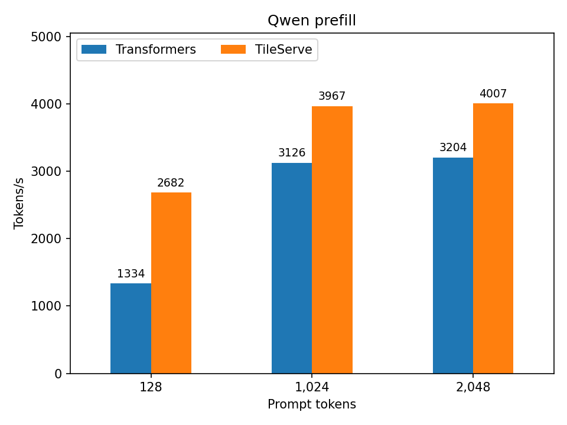
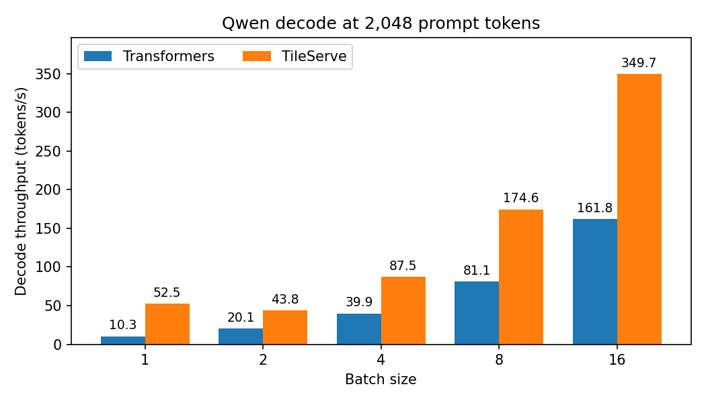
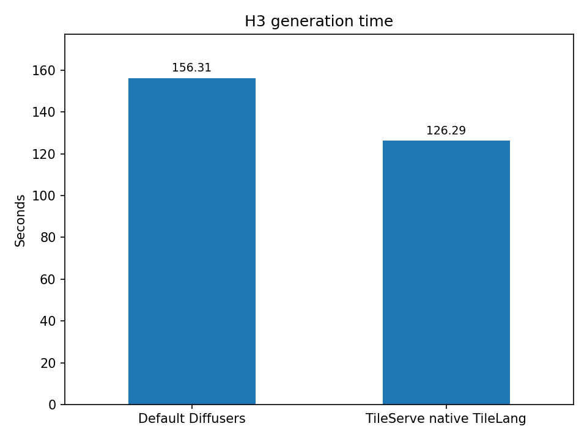
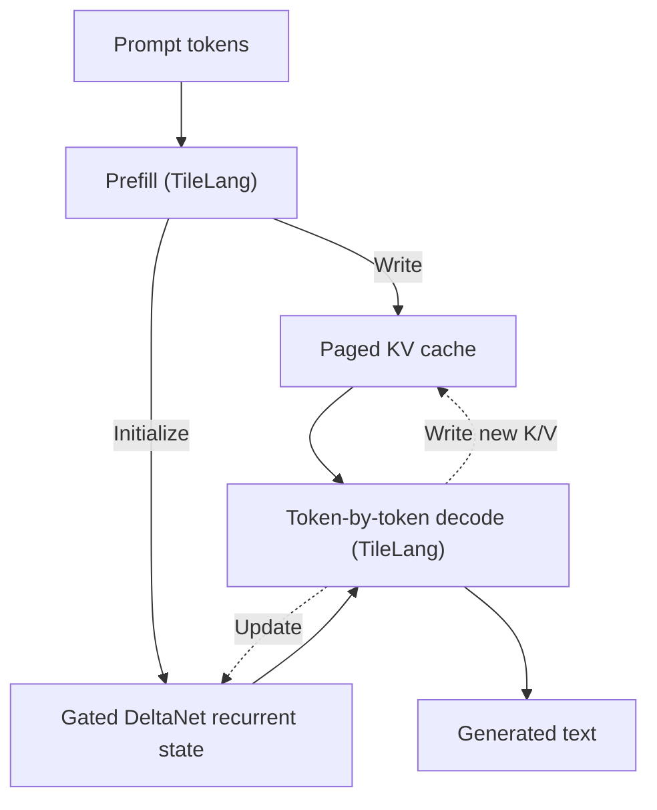
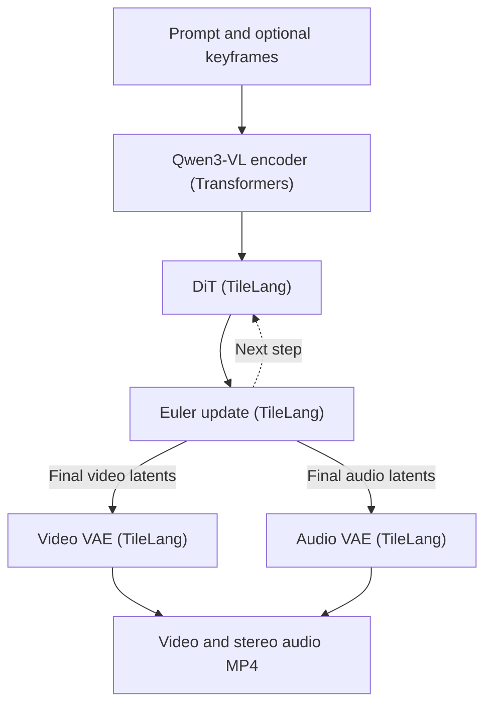

# Tile-Serve

Tile-Serve is a toy project that uses TileLang to run inference with Qwen3.8-27B-FP8 and MiniMax H3 Base FL2VA

The goal is to understand [TileLang](https://github.com/tile-ai/tilelang) and learn how inference systems work, with help from agents :)

## Quick start

Use a CUDA-enabled PyTorch environment with `nvcc` on your path.

```bash
python3 -m pip install -r requirements.txt
```

### Qwen3.8-27B-FP8

Download [Qwen3.8-27B-FP8 from Hugging Face](https://huggingface.co/Qwen/Qwen3.8-27B-FP8) into `model/Qwen3.8-27B-FP8`. Then,

```bash
python3 scripts/generate.py --model qwen3.8-fp8 --chat --think
```

### MiniMax H3 Base FL2VA

Download [MiniMax H3 from Hugging Face](https://huggingface.co/MiniMaxAI/MiniMax-H3) into `model/MiniMax-H3` and install FFmpeg. Native H3 runs without installing `diffusers`. Diffusers is only needed for the Diffusers-based comparison benchmarks.

```bash
python3 scripts/generate_video.py --prompt "A fox runs through a snowy forest." --output output/fox.mp4
```

**For now, I plan to support only these two models. I don't plan to add multi-token prediction (MTP), tensor parallelism (TP), multi-GPU execution or any other fancy stuff.**

The adapted MiniMax VAE components retain their [upstream Apache-2.0 notices](src/models/minimax_h3/video/LICENSE).

## Benchmarks

The batch-one prefill and H3 results use one **SM120** GPU (NVIDIA RTX PRO 6000 Blackwell Server Edition) with an AMD EPYC 9555 CPU (30 vCPUs), 88 GiB of host RAM, PyTorch 2.10.0+cu130, and TileLang 0.1.15.

### Qwen3.8-27B-FP8

For the prefill comparison, both backends used the same checkpoint and tokens at batch 1, with five measured runs after two warmups. The Transformers reference used Triton FP8, SDPA, and PyTorch DeltaNet and causal convolution.



TileServe prefill throughput was **101.0%, 26.9%, and 25.1% higher** than Transformers at 128, 1,024, and 2,048 prompt tokens, respectively. [Prefill results](test/result/qwen-prefill.json)

#### Batched decode

Both backends used the same checkpoint and token IDs on one RTX PRO 6000 Blackwell Workstation Edition (SM120). Each request started with 2,048 prompt tokens and ran for 64 decode steps. Bars show aggregate decode throughput after two warmups and five measured runs per batch size.



TileServe reached **2.15–5.08×** the Transformers decode throughput across the five batch sizes. At batch 16 it reached **349.7 vs 161.8 tok/s**, with **45.8 vs 98.9 ms/token** per request. [Decode results](test/result/qwen-decode-2048.json)

### MiniMax H3 FL2VA

The comparison uses the same checkpoint, prompt, and seed for a 640×384, 124-frame video over 49 DiT steps.

Each backend ran one first request. Generation time includes component placement and both VAE decodes, excluding checkpoint loading and MP4 encoding.

Default Diffusers took **156.31 s**, and TileServe native TileLang took **126.29 s**, a **19.2% reduction** in generation time. [H3 results](test/result/h3-generation.json)



## Architecture

### Qwen3.8-27B-FP8



#### GPU work in TileLang

TileLang covers the main CUDA operations in the Qwen forward pass, from token embedding to the output projection. The groups below show how those kernels serve the two layer types and the operations they share.

- **Shared projections** run in both attention and DeltaNet layers and in the MLP.
  - Single-row FP8 projections use GEMV with BF16 activations in the benchmark configuration. They read the compressed weights and apply their block scales in the kernel.
  - Multi-row FP8 projections quantize activations in 128-element groups, then run a tiled GEMM with FP32 accumulation. Unquantized projections use separate TileLang GEMV and GEMM kernels. [FP8 kernels](src/tileserve_kernels/qwen38/fp8.py) | [Unquantized kernels](src/tileserve_kernels/qwen38/linear.py)
- **Attention layers** use TileLang to compute variable-length prefill attention, write K/V into their GPU pages, and read those pages during decode. Split-KV decode divides long contexts into parallel attention partitions and merges their results. [KV writes](src/tileserve_kernels/qwen38/kvcache_store_paged.py) | [Split-KV decode](src/tileserve_kernels/comm/attn_decode_split_paged.py)
- **Gated DeltaNet layers** use TileLang to run causal convolution and update a fixed-size FP32 recurrent state. During a token range, each warp keeps a state column in registers and writes back the updated values. [DeltaNet kernels](src/tileserve_kernels/qwen38/delta.py)
- **Other forward operations** use TileLang kernels for embedding lookup, RMSNorm, partial RoPE, attention gating, residual adds, and SwiGLU. [Pointwise kernels](src/tileserve_kernels/qwen38/pointwise.py) | [SwiGLU](src/tileserve_kernels/comm/swiglu.py)

#### Runtime and cache management

Python packs the prompts, allocates the GPU buffers, and assigns physical pages through the page table. The paged KV cache uses 32-token pages by default. DeltaNet layers keep a rolling convolution buffer and a recurrent matrix per sequence. Decode reuses the state from prefill within a response, and each new chat turn builds fresh state from the conversation history. [Page allocation](src/paging/comm/page_table.py) | [Cache setup and forward pass](src/models/qwen38/model.py)

### MiniMax H3 FL2VA



#### GPU work by stage

- **[DiT](src/models/minimax_h3/video/dit.py)**
  - **TileLang:** Partial RoPE, packed SwiGLU, indexed AdaLN scale and shift, and gated residual updates.
  - **PyTorch:** Linear projections, RMSNorm, and scaled dot-product attention (SDPA).
  - **Why fuse:** Apply modulation and gates without writing separate per-token scale, shift, and gate tensors.
- **[Euler sampler](src/tileserve_kernels/minimax_h3/video.py)**
  - **TileLang:** Update the video and audio latents in place in FP32 after each DiT evaluation.
  - **PyTorch:** Prepare the noise schedules and step coefficients.
  - **Why fuse:** Combine the estimate and blend in one pass to avoid an intermediate latent tensor.
- **[Video VAE](src/models/minimax_h3/video/video_vae.py)**
  - **TileLang:** Fuse query/key RMSNorm with RoPE on the BF16 path and run packed SwiGLU.
  - **PyTorch:** Run linear projections, SDPA, and the post-quantization convolution. Batch and stitch spatial tiles.
  - **Why fuse:** Pass normalized Q/K values straight into the rotation and write each result once.
- **[Audio VAE](src/models/minimax_h3/video/audio_vae.py)**
  - **TileLang:** Fuse interpolation, SnakeBeta activation, and decimation for the anti-aliased activation.
  - **PyTorch:** Compute channel parameters and run the decoder's convolutions and transposed convolutions.
  - **Why fuse:** Keep the oversampled intermediate in shared memory across the activation and filtering steps.

#### Conditioning and memory placement

Transformers runs the Qwen3-VL encoder on PyTorch. To fit H3 within the sm120's **96 GB of VRAM**, the native runtime uses CPU checkpoint offloading, staging the encoder, DiT, video VAE, and audio VAE on the GPU as their stages begin. [Checkpoint placement](src/models/minimax_h3/native_placement.py)

## Script options

Pass `--help` to either generation script or benchmark for its command-line help.

### `scripts/generate.py`

| Option                                                  | What it does                                                                                   |
| ------------------------------------------------------- | ---------------------------------------------------------------------------------------------- |
| `--model` / `--model-path`                          | Select the FP8 model alias or give a checkpoint directory. Choose one.                         |
| `--chat`                                              | Start a chat session.                                                                          |
| `--prompt`                                            | Supply text directly. Repeat the option to batch prompts.                                      |
| `--think` / `--no-think`                            | Enable or disable reasoning in the chat template. Use with `--chat`.                         |
| `--max-new-tokens`, `--max-seq-len`                 | Limit response length and context length, respectively.                                        |
| `--temperature`, `--top-p`, `--top-k`, `--seed` | Control sampling. Temperature 0 uses greedy decoding.                                          |
| `--stream` / `--no-stream`, `--print-token-ids`   | Control streaming and print generated token IDs.                                               |
| `--device`, `--dtype`, `--block-size`             | Choose the device, activation dtype, and KV page size.                                         |
| `--qwen38-backend`, `--warmup`                      | Choose `tilelang` or `transformers`, or prepare TileLang kernels before the first request. |

### `scripts/generate_video.py`

| Option                                  | What it does                                                                           |
| --------------------------------------- | -------------------------------------------------------------------------------------- |
| `--prompt`, `--output`              | Required text prompt and output `.mp4` path.                                         |
| `--model-path`                        | Set the FL2VA checkpoint directory. Defaults to `model/MiniMax-H3`.                  |
| `--first-frame`, `--last-frame`     | Supply opening or closing keyframes. Install a Torchvision build that matches PyTorch. |
| `--width`, `--height`, `--frames` | Set output dimensions and frame count. Defaults are 640×384 and 124 frames.           |
| `--steps`, `--seed`, `--device`   | Set DiT evaluations, seed, and CUDA device. Defaults are 49, 42, and `cuda`.         |

<details>
<summary>Benchmark and plot options</summary>

**`test/qwen38_fp8/benchmark.py`**

The Transformers reference uses `kernels==0.18.3` and Triton 3.6.0.

- Required options are `--model` or `--model-path`, `--backend` (`transformers` or `tileserve`), and `--output`.
- `--batch-sizes`, `--prompt-tokens`, `--decode-steps`, `--warmups`, and `--repeats` define the workload. The RunPod decode chart uses `--batch-sizes 1 2 4 8 16 --prompt-tokens 2048`. The default is batch 1.
- `--device` selects a CUDA device, and `--dtype` accepts `auto` or `bf16` for this benchmark. The benchmark selects its own kernel configuration.

**`test/minimax_h3/bench_minimax_h3_video.py`**

Install `requirements-video-benchmark.txt` for the Diffusers backends.

- `--backend` and `--output` are required. The chart compares `diffusers` and `native`; the script also accepts `tilelang-rope`, `tilelang`, and `tilelang-attention`.
- `--backend native` runs the standalone TileServe pipeline. `--backend tilelang` runs Diffusers with selected TileLang kernels.
- `--model-path`, `--device`, `--prompt`, `--seed`, `--width`, `--height`, `--frames`, and `--steps` set the workload. Native FL2VA also accepts `--first-frame` and `--last-frame`.
- `--warmups`, `--warmup-steps`, and `--repeats` control measurement.
- `--memory-reserve`, `--checkpoint-offload`, and `--vae-tile-batch` control Diffusers placement and decoding. Use `--resident-dit` for native repeated requests.
- `--profile` exports a CUDA trace, `--trace` saves intermediate tensors, and `--reference` or `--media-reference` compares outputs. `--no-export` skips MP4 encoding.

**`test/common/plot_benchmarks.py`**

Run it with pandas and Matplotlib installed. It takes no arguments and renders the charts from the local JSON reports.

</details>
